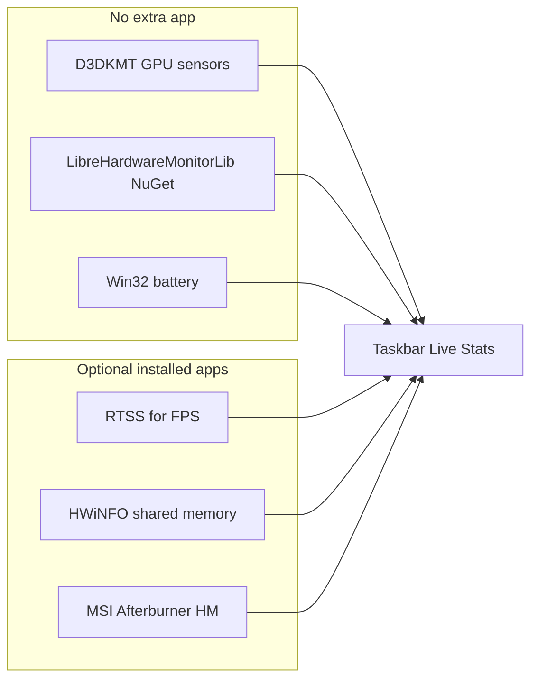

# Temps, FPS, and Extra Stats — Feasibility

## Short answers

| Question | Answer |
|----------|--------|
| Can we show temps / FPS / other sensors? | **Yes** |
| Must the user install HWiNFO / Afterburner? | **Not for most temps.** Those apps help, but are optional. **FPS almost always needs RTSS** (or HWiNFO reading RTSS). |
| Are HWiNFO / Afterburner open source? | **No** — freeware. True open-source path is **LibreHardwareMonitor**. |

Today the app only shows CPU, memory, GPU/VRAM, NPU, net, disk via PDH / Win32 ([`Metrics/`](src/TaskbarLiveStats/Metrics/)). No temp/FPS code yet ([`tasks.txt`](tasks.txt) line 1 already lists this as desired).

---

## What we can show

**Already in Taskbar Live Stats**

- CPU %, busiest cores
- RAM used/total
- GPU %, VRAM, busiest engines
- NPU (when present)
- Network up/down (+ totals)
- Disk read/write (+ totals)

**New sensors that fit the taskbar well**

| Metric | Typical unit | Best source |
|--------|--------------|-------------|
| CPU package / CCD temp | °C | LibreHardwareMonitor or HWiNFO |
| GPU temp | °C | D3DKMT (no install) or LHM / HWiNFO / Afterburner |
| Drive / SSD temp | °C | LHM or HWiNFO |
| Motherboard / chipset temp | °C | LHM or HWiNFO |
| Fan RPM (CPU/GPU/case) | RPM | LHM or HWiNFO |
| CPU / GPU power | W | LHM or HWiNFO |
| CPU / GPU clocks | MHz | LHM or HWiNFO |
| GPU fan / power / temp (limited) | — | Native `D3DKMT_ADAPTER_PERFDATA` |
| Gaming FPS (foreground) | FPS | **RTSS** shared memory (Afterburner installs RTSS) |
| Frametime / 1% low | ms / FPS | RTSS (advanced fields) |
| Battery % / remaining | % | Win32 (laptops; no 3rd-party app) |

Crowded-taskbar recommendation for v1 tiles: **CPU °C, GPU °C, FPS**, then optionally power / fans behind toggles.

---

## Apps / libraries needed

### Recommended stack (default)

1. **Temps / fans / power / clocks — LibreHardwareMonitorLib** (NuGet, open source)  
   - Embedded in the EXE; user does **not** install LibreHardwareMonitor.app  
   - Full CPU/GPU/drive/mobo sensors  
   - Often needs **Run as administrator** for complete readings (especially Intel/AMD package sensors)  
   - Add package to [`TaskbarLiveStats.csproj`](src/TaskbarLiveStats/TaskbarLiveStats.csproj)

2. **GPU temp/fan/power fallback — native D3DKMT**  
   - Same WDDM path Task Manager–style tools use (`Temperature` in deci-°C)  
   - No install; driver-dependent; complements existing DXGI/GPU code in [`GpuCollector.cs`](src/TaskbarLiveStats/Metrics/GpuCollector.cs)

3. **FPS — RivaTuner Statistics Server (RTSS)**  
   - Install [RTSS](https://www.guru3d.com/download/rtss-rivatuner-statistics-server-download/) (standalone) **or** MSI Afterburner (bundles RTSS)  
   - Read `RTSSSharedMemoryV2` for foreground-process FPS  
   - Show “—” / hide when no game is hooked

### Optional backends (if user already runs them)

| App | License | What you get | Setup |
|-----|---------|--------------|-------|
| **HWiNFO** | Freeware (not OSS) | All sensors + FPS if RTSS feeds it | Install + enable **Shared Memory Support** (Settings → HWiNFO Gadget) → map `Global\HWiNFO_SENS_SM2`. .NET helper: `Hwinfo.SharedMemory.Net` |
| **MSI Afterburner** | Freeware | GPU clocks/temps/fan/power via HM shared memory | Afterburner must be running |
| **RTSS** | Freeware | FPS / frametime | Must be running and hooking the game |
| **LibreHardwareService** | OSS | LHM sensors via shared memory without elevating the overlay | Extra service install; only if we refuse to request admin |

Graceful behavior: if a backend is missing, related tiles hide or show “N/A” — never crash.

---

## Implementation sketch (when you greenlight coding)

Wire like existing collectors:

- New collectors: e.g. `SensorCollector` (LHM + D3DKMT), `FpsCollector` (RTSS)
- Extend [`MetricsSnapshot.cs`](src/TaskbarLiveStats/Metrics/MetricsSnapshot.cs), [`MetricsHub.cs`](src/TaskbarLiveStats/Metrics/MetricsHub.cs)
- New `MetricKind`s + toggles in [`AppSettings.cs`](src/TaskbarLiveStats/Settings/AppSettings.cs) / Monitoring UI
- Render in [`GroupLayout.cs`](src/TaskbarLiveStats/UI/GroupLayout.cs) / [`StatsRenderer.cs`](src/TaskbarLiveStats/UI/StatsRenderer.cs)
- Settings: pick which temp (CPU Package vs Core Max vs GPU Hot Spot); temp color bands reuse existing usage-color pattern in [`tasks.txt`](tasks.txt)

---

## More features worth adding (beyond sensors)

From your [`tasks.txt`](tasks.txt) and natural follow-ons:

**Display / UX**

- Always on top (right-click menu)
- Hide overlay when a fullscreen / exclusive game is active
- Temp color thresholds (e.g. &lt;60 default, 60–85 warn, &gt;85 hot)
- Per-metric show/hide for CPU°C, GPU°C, FPS, power, fans

**Monitoring**

- History graphs for temps (same pattern as net/disk history + ScottPlot)
- Tray / toast alert when CPU/GPU temp crosses a limit
- Battery tile for laptops

**Gaming**

- FPS + optional frametime / 1% low when RTSS is present
- Auto-show FPS only while a game is detected; idle-hide otherwise

**Polish already listed in tasks**

- Fix CPU/GPU % vs Task Manager
- Per-part colors (border / icon / value / label)
- Value-based usage colors
- Tray left-click opens settings + displayer
- App/tray icon branding

---

## Practical install matrix for end users

| Goal | Install |
|------|---------|
| CPU/GPU/drive temps, fans, power | **Nothing** (LHM inside app); run elevated for best coverage |
| GPU temp only (basic) | Nothing (D3DKMT) |
| Gaming FPS | **RTSS** or **MSI Afterburner** |
| One external app for “everything” | **HWiNFO** + Shared Memory (+ RTSS if you want FPS) |
| Prefer zero admin | HWiNFO shared memory **or** LibreHardwareService |

---

## Verdict

Feasible and a good fit for this app. **Do not require HWiNFO/Afterburner for temps** — use LibreHardwareMonitorLib + D3DKMT. **Do document RTSS for FPS.** Treat HWiNFO/Afterburner as optional enrichments for power users who already run them.
